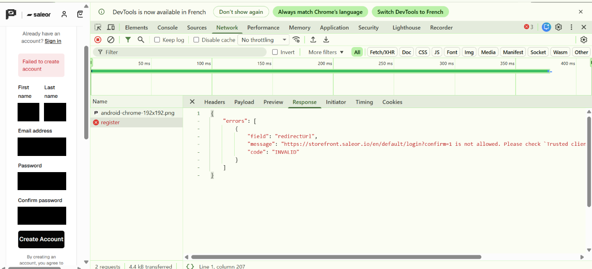
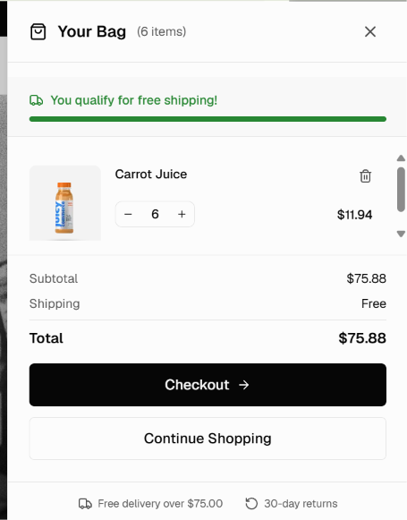
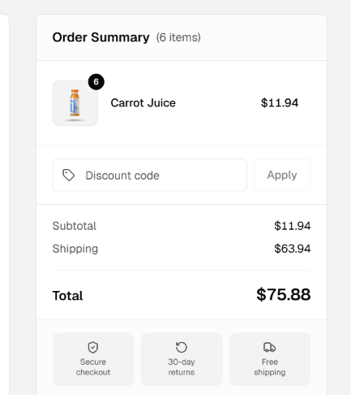
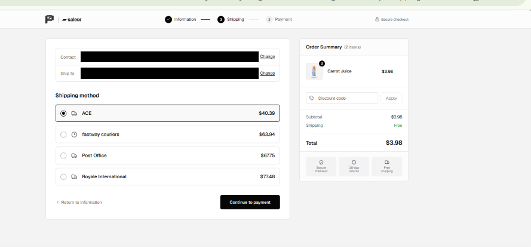

# Recette fonctionnelle d'une boutique e-commerce (Saleor Demo Store)

Projet personnel de QA : recette manuelle et exploratoire d'une application e-commerce open source, menée comme en entreprise. Plan de test, cas de test gérés dans Xray (Jira), exécution d'une campagne, déclaration d'anomalies et bilan.

| | |
|---|---|
| **Produit testé** | [Saleor Demo Store](https://storefront.saleor.io), boutique de démonstration publique |
| **Type de test** | Fonctionnel manuel, exploratoire, validations de formulaires |
| **Environnement** | Chrome (desktop), Windows |
| **Début du projet** | 5 novembre 2026 |
| **Outils** | Xray, Jira, Chrome DevTools, GitHub |

## Objectif

Vérifier que les parcours critiques d'un client fonctionnent (trouver un produit, remplir un panier, créer un compte, aller jusqu'à la caisse) et repérer les défauts de comportement, de robustesse et d'ergonomie. Ce projet m'a servi à pratiquer :
- la **recette** : plan de test, critères d'entrée et de sortie, campagne d'exécution, bilan ;
- la **gestion de tests dans un outil** : cas de test, étapes, exécution et statuts dans Xray ;
- le **test exploratoire** : sessions chartées et investigation avec les outils développeur du navigateur.

## État d'avancement

| Étape | Statut |
|---|---|
| Plan de test | Fait |
| Découverte du produit et premières anomalies | Faite |
| Conception de 41 cas de test dans Xray | Faite |
| Campagne d'exécution (Xray, « Exécution 1 ») | En cours |
| Sessions exploratoires | À venir |
| Bilan de recette Go / No-Go | À venir |

Les résultats chiffrés de la campagne seront ajoutés avec le bilan, une fois tous les cas exécutés.

## Périmètre

1. **Compte utilisateur** : inscription, connexion, déconnexion
2. **Recherche et catalogue** : recherche, catégories, filtres, fiche produit
3. **Panier et début de commande** : ajout, quantité, suppression, passage en caisse jusqu'à l'étape de paiement

Hors périmètre : paiement réel, performance, sécurité, administration, automatisation.

## Méthode

- **Plan de test** ([plan-de-test.md](plan-de-test.md)) : périmètre, approche, critères Go / No-Go, échelle de gravité et risques, définis avant l'exécution.
- **Cas de test** : 41 cas (nominaux, limites, erreurs, ergonomie), chacun avec ses étapes et son résultat attendu. La liste complète est dans [cas-de-test.csv](cas-de-test.csv).
- **Exécution** : un ticket « Test Execution » dans Xray, avec un statut par cas (Passed, Failed, etc.).
- **Anomalies** : décrites avec étapes de reproduction, résultat attendu, résultat obtenu, gravité et preuve.

### Exemples de cas de test

| ID | Cas | Type | Résultat attendu |
|---|---|---|---|
| TC-ACC-01 | Inscription avec des données valides | Nominal | Le compte est créé |
| TC-SRC-03 | Recherche avec des caractères spéciaux (`%&<>'`) | Limite | Aucune erreur technique, comportement maîtrisé |
| TC-PAN-08 | Cohérence du sous-total entre le panier et la caisse | Nominal | Le sous-total reste égal à la somme des produits |
| TC-CMD-08 | Libellé des frais de livraison avant le choix du mode | Ergonomie | Les frais ne sont pas annoncés « Free » avant d'être calculés |

## Exemples d'anomalies

Les anomalies détectées pendant la phase de découverte sont décrites dans [anomalies.md](anomalies.md). Elles seront confirmées ou infirmées par la campagne. En voici trois.

### Création de compte impossible (gravité proposée : bloquante)

À la création d'un compte, l'interface affiche seulement « Failed to create account ». Les outils développeur montrent que la requête `POST /api/auth/register` renvoie une erreur 400 : le serveur refuse l'URL de redirection envoyée (`redirectUrl`). L'utilisateur ne peut pas savoir pourquoi, et aucun compte ne peut être créé.



### Sous-total du panier incohérent avec la caisse (gravité proposée : majeure)

Pour 6 jus à 1,99 $, la caisse affiche un sous-total de 11,94 $ et 63,94 $ de livraison, soit 75,88 $ au total. Le panier affiche un sous-total de 75,88 $ avec le message « You qualify for free shipping! ». Cette anomalie est à reproduire proprement avant d'être confirmée.




### Frais de livraison annoncés « Free » avant d'être calculés (gravité proposée : mineure)

Aux premières étapes de la caisse, le récapitulatif affiche « Shipping : Free » pour un total de 3,98 $. Les frais réels (entre 40,39 $ et 77,48 $) n'apparaissent qu'à la dernière étape.



## Limites de l'environnement

Le site testé est une démonstration publique, ce qui limite certains tests :
- l'inscription échoue, donc les cas de connexion et de déconnexion ne sont pas exécutables normalement ;
- aucune passerelle de paiement n'est configurée, donc le paiement ne peut pas être testé.

Ces cas sont traités comme des cas bloqués, avec une justification, comme dans une recette réelle.

## Ce que j'ai appris

- Le statut d'un ticket dans Jira (« Terminé ») n'est pas le résultat d'un test. Le résultat vit dans l'exécution Xray (Passed, Failed).
- L'import de cas de test dans un outil demande un format précis : un fichier mal structuré a décalé des résultats attendus, ce que j'ai repéré et documenté.
- Une bonne anomalie s'appuie sur une preuve technique (ici la réponse du serveur dans les outils développeur), pas seulement sur le message affiché.

## Contenu du dépôt

```
.
├── README.md
├── plan-de-test.md     Plan de test
├── cas-de-test.csv     Les 41 cas de test
├── anomalies.md        Anomalies avec étapes de reproduction
├── xray/               Fichiers d'import dans Xray
└── captures/           Captures d'écran (données personnelles masquées)
```

Les données personnelles visibles lors des tests ont été masquées avant publication.
